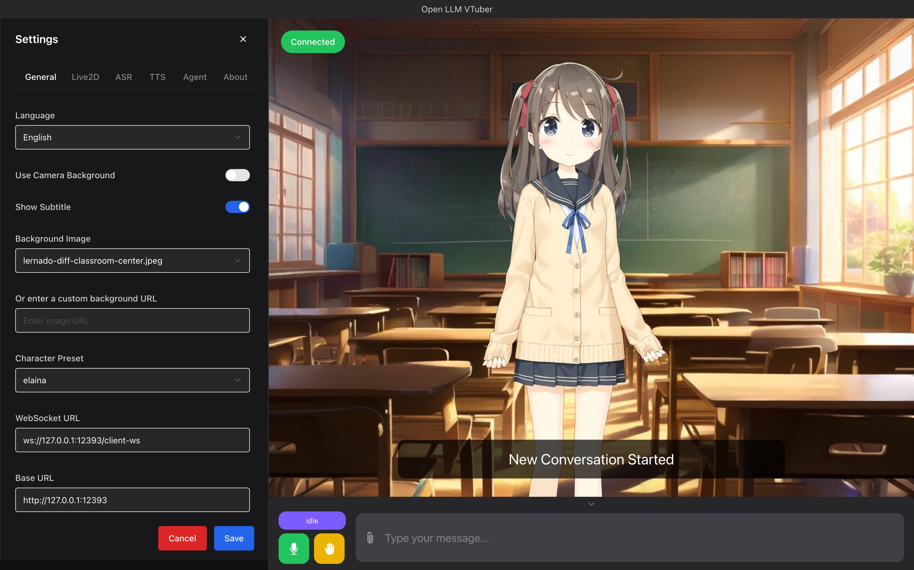
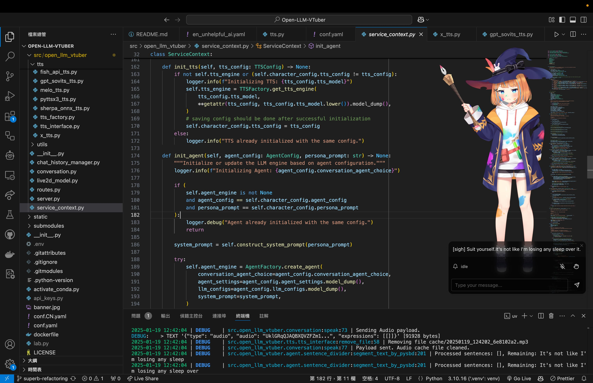
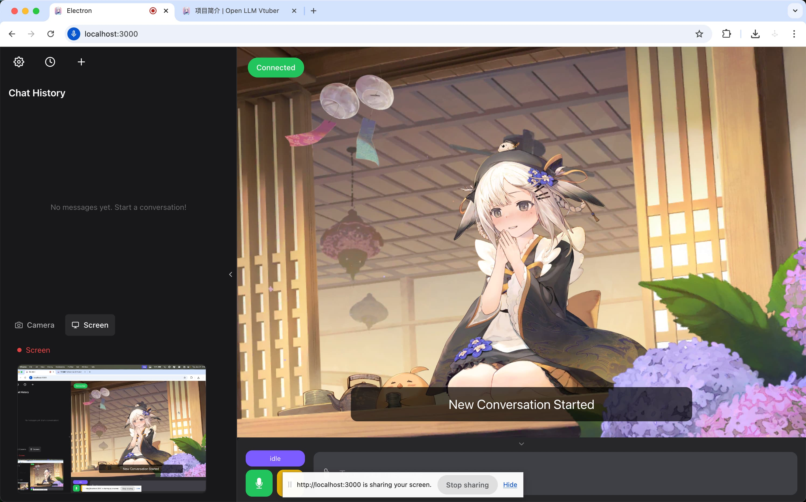
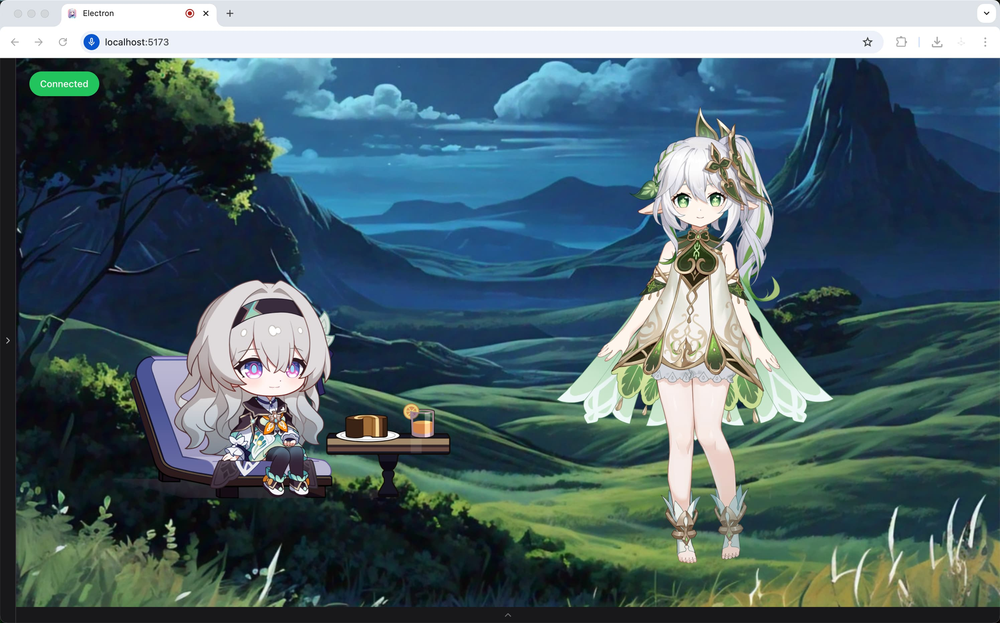

<h1 align="center">Live2D-Ai — PC Client</h1>
<h3 align="center">Open-LLM-VTuber fork · WSL2 / Ubuntu Linux Preview</h3>

> ⚠️ **这是一个 fork 说明，不是上游 Open-LLM-VTuber 的官方 README。**
> 本项目 `Live2D-Ai-pc/open-llm-vtuber/` 是 [Open-LLM-VTuber](https://github.com/Open-LLM-VTuber/Open-LLM-VTuber)（MIT）的派生分支，加入 Live2D-Ai 的导演半身动作、本地 Melo TTS、分条消息等修改。上游原始代码保留 MIT 许可（见本目录 `LICENSE`）；**Live2D-Ai 在此之上新增/修改的代码按项目根目录 `LICENSE`（AGPL-3.0-only）授权**。第三方组件仍遵循各自许可。

## 支持范围（v0.2.0-preview.1）

- ✅ 支持：WSL2、Ubuntu/Linux（源码 Preview）
- ❌ 不支持：原生 Windows、macOS（未测试）、Android（不属于本次发布）

## 公共 Preview 不捆绑、需自行取得

1. **Live2D Cubism Web Core**（`live2dcubismcore.min.js`）：专有 Redistributable Code，本发布**不分发**。请从 [Live2D 官方](https://www.live2d.com/)接受 [Live2D Proprietary Software License](https://www.live2d.com/eula/live2d-proprietary-software-license-agreement_en.html) 后下载，放入 renderer 加载路径（`renderer/public/libs/`）。
2. **Live2D 模型**：本发布**不分发任何模型原文件**。例如 `bai`（白-免费版）出自作者发布视频 [BV1NqNFejEeE](https://www.bilibili.com/video/BV1NqNFejEeE/)，需用户自行合法取得后，在设置页「形象 / 背景」→「上传 Live2D 模型 (.zip)」导入。
3. **API Key 与 TTS/ASR 配置**：本发布**不内置任何共享 / 免费 Key**。请自行从 LLM / TTS / ASR 服务商申请并在设置页或 `.env` 配置。

## 启动

```bash
cd Live2D-Ai-pc/open-llm-vtuber
uv sync --locked
cd renderer && npm ci && npm run build && cd ..
uv run run_server.py
# 浏览器访问 http://127.0.0.1:12393/
```

> 未配置 Key / 模型 / Cubism Core 时服务仍可启动并打开设置页；缺失项会在页面或日志中给出可操作的指引。

---

### 上游 Open-LLM-VTuber README（历史归档）

以下内容为上游 [Open-LLM-VTuber](https://github.com/Open-LLM-VTuber/Open-LLM-VTuber) 的原 README，仅作历史参考。**其中声明的 Windows/macOS/Linux 全平台支持、Live2D sample models、上游社区/文档链接均描述的是上游项目，不代表本 fork 的 v0.2.0-preview.1 支持范围。**

> :warning: If you want to run the server remotely and access it on a different machine, such as running the server on your computer and access it on your phone, you will need to configure `https`, because the microphone on the front end will only launch in a secure context (a.k.a. https or localhost). See [MDN Web Doc](https://developer.mozilla.org/en-US/docs/Web/API/MediaDevices/getUserMedia). Therefore, you should configure https with a reverse proxy to access the page on a remote machine (non-localhost).


## ⭐️ What is this project?


**Open-LLM-VTuber** is a unique **voice-interactive AI companion** that not only supports **real-time voice conversations**  and **visual perception** but also features a lively **Live2D avatar**. All functionalities can run completely offline on your computer!

You can treat it as your personal AI companion — whether you want a `virtual girlfriend`, `boyfriend`, `cute pet`, or any other character, it can meet your expectations. The project fully supports `Windows`, `macOS`, and `Linux`, and offers two usage modes: web version and desktop client (with special support for **transparent background desktop pet mode**, allowing the AI companion to accompany you anywhere on your screen).

Although the long-term memory feature is temporarily removed (coming back soon), thanks to the persistent storage of chat logs, you can always continue your previous unfinished conversations without losing any precious interactive moments.

In terms of backend support, we have integrated a rich variety of LLM inference, text-to-speech, and speech recognition solutions. If you want to customize your AI companion, you can refer to the [Character Customization Guide](https://open-llm-vtuber.github.io/docs/user-guide/live2d) to customize your AI companion's appearance and persona.

The reason it's called `Open-LLM-Vtuber` instead of `Open-LLM-Companion` or `Open-LLM-Waifu` is because the project's initial development goal was to use open-source solutions that can run offline on platforms other than Windows to recreate the closed-source AI Vtuber `neuro-sama`.

### 👀 Demo
|  |  |
|:---:|:---:|
|  |  |


## ✨ Features & Highlights

- 🖥️ **Cross-platform support**: Perfect compatibility with macOS, Linux, and Windows. We support NVIDIA and non-NVIDIA GPUs, with options to run on CPU or use cloud APIs for resource-intensive tasks. Some components support GPU acceleration on macOS.

- 🔒 **Offline mode support**: Run completely offline using local models - no internet required. Your conversations stay on your device, ensuring privacy and security.

- 💻 **Attractive and powerful web and desktop clients**: Offers both web version and desktop client usage modes, supporting rich interactive features and personalization settings. The desktop client can switch freely between window mode and desktop pet mode, allowing the AI companion to be by your side at all times.

- 🎯 **Advanced interaction features**:
  - 👁️ Visual perception, supporting camera, screen recording and screenshots, allowing your AI companion to see you and your screen
  - 🎤 Voice interruption without headphones (AI won't hear its own voice)
  - 🫱 Touch feedback, interact with your AI companion through clicks or drags
  - 😊 Live2D expressions, set emotion mapping to control model expressions from the backend
  - 🐱 Pet mode, supporting transparent background, global top-most, and mouse click-through - drag your AI companion anywhere on the screen
  - 💭 Display AI's inner thoughts, allowing you to see AI's expressions, thoughts and actions without them being spoken
  - 🗣️ AI proactive speaking feature
  - 💾 Chat log persistence, switch to previous conversations anytime
  - 🌍 TTS translation support (e.g., chat in Chinese while AI uses Japanese voice)

- 🧠 **Extensive model support**:
  - 🤖 Large Language Models (LLM): Ollama, OpenAI (and any OpenAI-compatible API), Gemini, Claude, Mistral, DeepSeek, Zhipu AI, GGUF, LM Studio, vLLM, etc.
  - 🎙️ Automatic Speech Recognition (ASR): sherpa-onnx, FunASR, Faster-Whisper, Whisper.cpp, Whisper, Groq Whisper, Azure ASR, etc.
  - 🔊 Text-to-Speech (TTS): sherpa-onnx, pyttsx3, MeloTTS, Coqui-TTS, GPTSoVITS, Bark, CosyVoice, Edge TTS, Fish Audio, Azure TTS, etc.

- 🔧 **Highly customizable**:
  - ⚙️ **Simple module configuration**: Switch various functional modules through simple configuration file modifications, without delving into the code
  - 🎨 **Character customization**: Import custom Live2D models to give your AI companion a unique appearance. Shape your AI companion's persona by modifying the Prompt. Perform voice cloning to give your AI companion the voice you desire
  - 🧩 **Flexible Agent implementation**: Inherit and implement the Agent interface to integrate any Agent architecture, such as HumeAI EVI, OpenAI Her, Mem0, etc.
  - 🔌 **Good extensibility**: Modular design allows you to easily add your own LLM, ASR, TTS, and other module implementations, extending new features at any time


## 👥 User Reviews
> Thanks to the developer for open-sourcing and sharing the girlfriend for everyone to use
> 
> This girlfriend has been used over 100,000 times


## 🚀 Quick Start

Please refer to the [Quick Start](https://open-llm-vtuber.github.io/docs/quick-start) section in our documentation for installation.


## ☝ Update
> :warning: `v1.0.0` has breaking changes and requires re-deployment. You *may* still update via the method below, but the `conf.yaml` file is incompatible and most of the dependencies needs to be reinstalled with `uv`. For those who came from versions before `v1.0.0`, I recommend deploy this project again with the [latest deployment guide](https://open-llm-vtuber.github.io/docs/quick-start).

Please use `uv run update.py` to update if you installed any versions later than `v1.0.0`.

## 😢 Uninstall  
Most files, including Python dependencies and models, are stored in the project folder.

However, models downloaded via ModelScope or Hugging Face may also be in `MODELSCOPE_CACHE` or `HF_HOME`. While we aim to keep them in the project's `models` directory, it's good to double-check.  

Review the installation guide for any extra tools you no longer need, such as `uv`, `ffmpeg`, or `deeplx`.  

## 🤗 Want to contribute?
Checkout the [development guide](https://docs.llmvtuber.com/docs/development-guide/overview).


# 🎉🎉🎉 Related Projects

[ylxmf2005/LLM-Live2D-Desktop-Assitant](https://github.com/ylxmf2005/LLM-Live2D-Desktop-Assitant)
- Your Live2D desktop assistant powered by LLM! Available for both Windows and MacOS, it senses your screen, retrieves clipboard content, and responds to voice commands with a unique voice. Featuring voice wake-up, singing capabilities, and full computer control for seamless interaction with your favorite character.


## 📜 Third-Party Licenses

### Live2D Cubism Web Core & Model Assets

- **Live2D Cubism Web Core** (`live2dcubismcore.min.js`) is proprietary
  Redistributable Code owned by Live2D Inc., governed by the
  [Live2D Proprietary Software License](https://www.live2d.com/eula/live2d-proprietary-software-license-agreement_en.html).
  This fork's PC-only Preview does **not** distribute it; users must obtain it
  from Live2D's official channel and accept the license before use.
- Live2D model files (e.g., `bai`) are third-party assets under the model
  author's custom terms. This Preview does **not** bundle raw model files;
  users must obtain them lawfully (e.g., from the author's Bilibili release)
  and import them locally. They are not covered by this fork's license.
- The upstream Open-LLM-VTuber project may reference Live2D sample models
  under the Live2D Free Material License; those statements describe the
  upstream project, not this fork's distribution.


## Contributors
Thanks our contributors and maintainers for making this project possible.

<a href="https://github.com/Open-LLM-VTuber/Open-LLM-VTuber/graphs/contributors">
  
</a>


## Star History

[](https://star-history.com/#Open-LLM-VTuber/open-llm-vtuber&Date)


