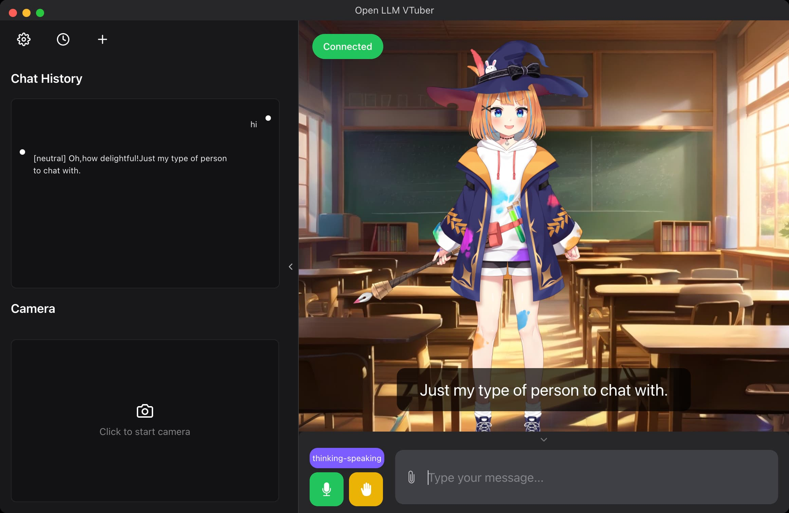
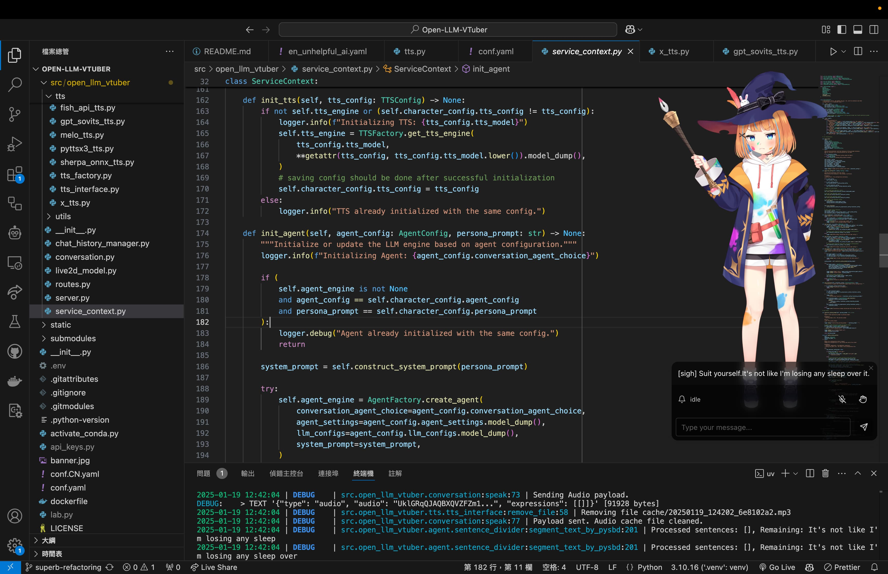

# Live2D-Ai 🐱

> **v0.2.0-preview.1（准备中）**：首个公开版本仅承诺 PC（WSL2 / Ubuntu Linux）源码 Preview。Android、原生 Windows 与 macOS 不属于本次支持范围。Preview 不捆绑白模型原文件，用户需从作者渠道合法取得并自行导入。
>
> **Live2D + AI 最小验证项目** — 验证「最小化的 AI + Live2D」闭环能跑通：文本/语音 → LLM → Live2D 表情/口型/动作。项目意义只有一件：最小代价验证链路可行 + 留下扩展接口供后续和社区开发 mod——所以叫 Live2D-Ai。

<p align="center">
  
  
  
  
  
  
</p>

---

## 🎯 项目哲学 | Philosophy

> **不做功能竞赛，只打磨一个最小最优秀的核心。**

Live2D-Ai = Live2D + AI + TTS。项目的全部意义只有一件事：**做一个类似 pi agent 的最小最优秀的核心**——把「文本/语音 → LLM → TTS → Live2D 表情/口型/动作」这条链路打磨到极致：架构干净、代码精简、每行都有真机/测试证据，**并留下扩展接口供后续和社区开发 mod**。刻意不做功能竞赛：不比 N.E.K.O. 生态、不比 Neuro-sama 包装。

```
┌──────────────────────────────────────┐
│       扩展层（插件 SDK / 契约接口）      │
│  视觉 / 语音 / 多模型 / 多皮肤 / 直播    │  ← 后续与社区开发 mod，不碰核心
├──────────────────────────────────────┤
│            最小最优秀核心             │
│ 文本/语音 → LLM → TTS → 表情/口型/动作 │  ← 只打磨这一条链路
└──────────────────────────────────────┘
```

- **核心只留最小闭环**：文本/语音 → LLM 理解 → TTS 合成 → Live2D 表情/口型/动作回应——这条链路打磨到"可行、可复制、可验证"
- **像 pi agent 一样做核心**：状态机驱动、单一职责文件、测试先行（663 JVM 断言）、开源组件拼装（官方 Cubism 框架 + PurismCore + minimp3 + sherpa-onnx，全部开源许可）
- **扩展（mod）**：视觉、语音、多模型、多皮肤、直播……全部走插件 SDK / 共享契约接口，留给后续和社区，不碰核心
- **不做功能竞赛**：不比 N.E.K.O. 生态、不比 Neuro-sama 包装。项目的全部意义 = 验证最小闭环可行 + 留下扩展接口。

---

## 📖 项目简介 | Overview

**Live2D-Ai** 是一个 **AI × Live2D 最小验证项目**——验证「最小化的 AI + Live2D」闭环能跑通：她使用 **Live2D 模型角色** 与您进行 **语音对话**，通过 **大语言模型 (LLM)** 理解并回应您，同时根据对话情感实时切换表情、驱动口型。核心只留这一条最小闭环，扩展全部走插件 SDK / 契约接口留给后续和社区。

> "欢迎回来～今天也要一起加油哦！" —— 白 (Bai)

**关于 Live2D 渲染（两套实现，许可不同）**：

- **Android 端**：基于 [Purism Core](https://github.com/SakuraMotion/PurismCore)（MIT 开源许可）替代 Live2D 官方的闭源 Cubism SDK。
- **PC 端（WSL2/Linux）**：基于 [Open-LLM-VTuber](https://github.com/Open-LLM-VTuber/Open-LLM-VTuber)（MIT）构建，其 Web 渲染依赖 **Live2D Cubism Web Core**（`live2dcubismcore.min.js`），这是 **Live2D 公司的专有 Redistributable Code，不适用 AGPL/MIT**。PC-only Preview 公共发布树**不分发**该文件，也**不分发任何 Live2D 模型/TTS/ASR 模型/API Key**；用户需自行从 [Live2D 官方](https://www.live2d.com/)接受许可并下载 Cubism Web Core，并合法取得模型后本地导入。因此 PC Preview 并非“完全可复制、无需接受 Live2D 许可”。

---

## ✨ 特性 | Features

### 🎯 最小核心闭环（v0 现状）

**文本 → LLM → 表情/动作**：

- 本地配置聊天（密钥不提交）：Android 端在 `Live2D-Ai-Android/local.properties` 配置 `DEEPSEEK_API_KEY`（build.gradle 自动读入 BuildConfig）后即可聊天——默认 **DeepSeek**（智谱 GLM 提供商已移除）；PC 端在仓库根 `.env` 配置 `DEEPSEEK_API_KEY`（亦可配置 `ZHIPU_API_KEY` 走智谱 GLM，用于视觉/免费兜底，见 `Live2D-Ai-pc/README.md`）。密钥只存在于 gitignored 本地文件，不进入 git 历史
- LLM 回复解析 `[emotion]` 标签 → Live2D 表情/动作切换

**Live2D 渲染（Android 端）**：

- Purism Core (MIT) 替代闭源 Cubism Core（Android 端开源；PC 端渲染依赖 Live2D 专有 Cubism Web Core，见上文许可说明）
- 完整的 OpenGL ES 2.0 渲染管线：Premultiplied Alpha、裁剪掩码、MSAA 4x
- 三线性过滤 + Mipmap，呈现光滑边缘
- 支持 Cubism 5.0 MOC3 模型格式

**情感联动**：

- LLM 回复中的 `[emotion]` 标签（`[joy]`, `[sadness]`, `[anger]` 等）实时切换表情和语气
- 完整的眨眼、呼吸、物理效果（辫子摆动）

**双端**：

- Android 端（Kotlin + Compose + Purism Core）
- PC 端（WSL2/Linux 主力 · Open-LLM-VTuber，支持 120fps 渲染；共享 `shared/persona.yaml` 人设文件，两端人设统一）

### 🔌 扩展层（mod 接口，已实现未入 v0 验收）

> 扩展能力全部走插件 SDK / 共享契约接口，不碰核心。以下为已实现的 mod 接口实例。

- **语音输入 ASR**：Android 系统 SpeechRecognizer / Sherpa-Onnx
- **语音合成 TTS**：Edge TTS / CosyVoice / Sherpa-Onnx 降级链
- **视觉识别**：GLM-4.6V 多模态截图分析（模型能看到屏幕内容）——已迁出为插件模块 **live2d-ai-plugin-vision**（mod 接口实例）

### 🚀 Roadmap（计划中，未入当前版本）

- [ ] Android 悬浮窗模式（后台 Service + 悬浮窗权限）
- [ ] 多模型切换 UI
- [ ] 触摸互动反馈
- [ ] 对话气泡 Canvas 渲染
- [ ] MCP 工具集成

---

## 📸 PC Preview 截图 | Screenshots

| PC 对话与语音闭环 | PC 桌宠模式 |
|---|---|
|  |  |

> 截图中的模型仅用于功能展示；PC-only 公共 Preview 不捆绑其原始模型文件。

---

## 🚀 快速开始 | Quick Start

### 环境要求 | Prerequisites

| 工具 | 版本 | 用途 |
| ------ | ------ | ------ |
| Android Studio / Gradle | 8.7+ | Android 构建 |
| JDK | 17+ | Kotlin 编译 |
| NDK | 27.0.12077973 | Purism Core C 编译（自动下载） |
| Android SDK | API 35 (compileSdk) | 目标平台 |
| Android 手机 | API 26+ (Android 8.0+) | 运行设备 |

### 构建 APK | Build

```bash
# 克隆项目
git clone https://github.com/yuhanwanli99-cpu/Live2Dai.git
cd Live2D-Ai-Android

# 构建 Debug APK（NDK 会自动下载）
./gradlew assembleDebug

# APK 路径
# app/build/outputs/apk/debug/app-debug.apk
```

### 部署到手机 | Deploy

```bash
# 无线 ADB 连接（替换为你的手机 IP）
adb connect 192.168.0.x:5555

# 卸载旧版本（某些系统必须完整卸载）
adb uninstall com.live2d.ai.android

# 安装
adb install app/build/outputs/apk/debug/app-debug.apk

# 启动
adb shell am start -n com.live2d.ai.android/.MainActivity
```

> **注意**：vivo / OPPO 等系统会在安装时弹出安全验证弹窗，需在手机上手动确认。

### PC Preview（WSL2 / Ubuntu Linux）

```bash
git clone https://github.com/yuhanwanli99-cpu/Live2Dai.git
cd Live2Dai/Live2D-Ai-pc/open-llm-vtuber
uv sync --locked
cd renderer && npm ci && npm run build && cd ..
uv run run_server.py
# 浏览器访问 http://localhost:12393/
```

支持等级：WSL2 与 Ubuntu/Linux 为 Preview 支持目标；原生 Windows 不支持，macOS 未测试，Android 不属于本次发布。

> **PC Preview 不捆绑、需用户自行取得的三样东西**：
> 1. **Live2D Cubism Web Core**（`live2dcubismcore.min.js`）：从 [Live2D 官方](https://www.live2d.com/)接受其专有许可后下载，放到 `Live2D-Ai-pc/open-llm-vtuber/renderer/public/libs/`（或对应加载路径），缺少时页面无法渲染角色。
> 2. **Live2D 模型**：从模型作者合法渠道取得 ZIP 后，在设置页「形象 / 背景」→「上传 Live2D 模型 (.zip)」导入（例如 `bai`（白-免费版）出自作者发布视频 [BV1NqNFejEeE](https://www.bilibili.com/video/BV1NqNFejEeE/)）。
> 3. **LLM / TTS / ASR 服务的 API Key 与配置**：项目不内置任何共享或免费 Key，请自行从服务商申请并填入。

> **密钥策略**：项目**不内置任何共享 / 免费 Key，也不提供免费兜底 Provider**。
> 首次运行前请在仓库根 `.env` 填入自己的 Key（如 `DEEPSEEK_API_KEY=sk-...`），
> 或在设置页「密钥」分区填写。未填也能启动：后端照常起、设置页可用，
> 但第一次对话会在聊天面板里给出「去哪里填哪个 Key」的明确提示。

#### 让外部程序说话（可选，默认关闭）

设置页 →「外部接入」打开开关后，本机其它程序即可把一句话交给角色，
走与聊天框输入**完全相同**的内部链路（同人设 / 同记忆 / 同 TTS 与口型）：

```bash
curl -X POST http://127.0.0.1:12393/api/external/chat \
  -H 'Content-Type: application/json' \
  -d '{"text":"提醒我该喝水了","wait_reply":true}'
```

默认只允许本机调用；要放开局域网必须在设置页勾选「允许局域网」并生成访问令牌，
随时可点「立即断开」停止接收。完整契约见
[docs/architecture/external-text-input.md](docs/architecture/external-text-input.md)。

#### 换角色背景图（可选）

设置页 →「形象 / 背景」→「上传背景图」，选一张本地图片即刻生效（铺在角色之下，不影响模型渲染）；
选「无背景」回到透明桌宠形态。图片存放于 `Live2D-Ai-pc/open-llm-vtuber/backgrounds/`（不入库）。

### 运行测试 | Run Tests

```bash
# 本地健康自检（无 Key、无网络）
python scripts/health_check.py

# 一键地基验证：健康检查 + 一致性 + 根测试
python scripts/verify_all.py

# Android 端测试
cd Live2D-Ai-Android && ./gradlew test

# PC 端（WSL2/Linux）测试
cd Live2D-Ai-pc/open-llm-vtuber
uv sync --locked
uv run pytest tests/
cd renderer
npm ci
npm test
npm exec tsc -- --noEmit
npm run build
```

> 地基文档索引见 [docs/README.md](docs/README.md)，目录约定见 [docs/architecture/directory.md](docs/architecture/directory.md)。

---

## 🏗️ 架构 | Architecture

### 整体架构

**两端独立直连 LLM API**，无中心化后端，共享 `shared/persona.yaml` 人设配置：

```
┌─────────────────────────────┐     ┌─────────────────────────────────┐
│   Android (Kotlin + Compose)│     │   PC 端 (WSL2/Linux) · Open-LLM-VTuber │
│                             │     │                                 │
│   DeepSeek API ─────────────┼─────┼─── DeepSeek API                 │
│        (OkHttp SSE)         │     │                                 │
│                             │     │   Edge TTS                      │
│   Edge TTS ─────────────────┼─────┼───                              │
│                             │     │                                 │
│   GLM-4.6V 视觉 ────────────┼─────┼─── GLM-4.6V 视觉               │
│                             │     │                                 │
│   Purism Core ──────────────┤     │   Live2D Web (Cubism SDK)      │
│   (原生 C 渲染引擎)          │     │                                 │
│                             │     │   Open-LLM-VTuber (Python)      │
│   共享人设: persona.yaml ────┼─────┼─── 共享人设: persona.yaml        │
└─────────────────────────────┘     └─────────────────────────────────┘
```

### 渲染管道 (每帧)

```
onDrawFrame():
  1. AnimationPipeline.update(deltaTime)
     ├─ MotionManager      ← 当前播放动作
     ├─ EyeBlinkManager    ← 自然眨眼
     ├─ BreathController   ← 胸部起伏
     ├─ PhysicsManager     ← 物理效果（辫子等）
     ├─ model.update()     ← 第一次更新
     ├─ Pose.update()      ← 隐藏后臂/肢体重叠
     └─ model.update()     ← 第二次更新（Pose 生效）
  2. refreshCachedAttributes()
  3. buildDrawableList()   ← 按 renderOrder 排序
  4. drawObjectLoop()
     ├─ 裁剪掩码 FBO（需要时）
     ├─ 设置着色器参数
     └─ glDrawElements
```

### 配置流

```
shared/persona.yaml  ← 单源真理 (Single Source of Truth)
    ├──→ Android: Live2D-Ai-Android/app/src/main/assets/persona.yaml
    └──→ Desktop:  Live2D-Ai-pc/conf.yaml
```

---

## 💻 技术栈 | Tech Stack

### Android 端

| 组件 | 技术 | 版本 |
| ------ | ------ | ------ |
| UI 框架 | Jetpack Compose + Material3 | BOM 2024.12 |
| 语言 | Kotlin | 2.1 |
| LLM API | DeepSeek Chat (OpenAI 兼容) | deepseek-v4-flash |
| 视觉模型 | GLM-4V (Zhipu) | glm-4.6v |
| Live2D 原生 | **Purism Core** (MIT) | latest |
| Live2D Java | CubismJavaFramework | develop |
| 语音合成 | Edge TTS（降级链） | — |
| 语音识别 | Android SpeechRecognizer | API 26+ |
| 构建 | Gradle + Kotlin DSL + AGP | 8.7.3 |
| NDK | 27.0.12077973 | CMake |
| 最低 SDK | Android 8.0 | API 26 |

### PC 端（WSL2/Linux 主力）

| 组件 | 技术 |
| ------ | ------ |
| 运行时 | Python 3.10+ (FastAPI + WebSocket) |
| LLM | DeepSeek API |
| 视觉 | Zhipu GLM-4.6V |
| TTS | Edge TTS |
| ASR | Faster Whisper (large-v3-turbo) |
| VAD | Silero VAD |
| Live2D | Cubism SDK for Web |
| 前端 | React + ChakraUI + Vite |

---

## 🎨 自定义指南 | Customization

### 换模型 | Change Model

1. 将 Live2D 模型文件夹（含 `.model3.json` + `.moc3` + 纹理图片）放入：

   ```bash
   Live2D-Ai-Android/app/src/main/assets/live2d/<model-name>/runtime/
   ```

2. 修改 `Live2DRenderer.kt` 中的模型加载路径：

   ```kotlin
   // 在 loadModel() 中
   private val modelPath = "live2d/<model-name>/runtime/"
   ```

3. 重新编译

   ```bash
   ./gradlew assembleDebug
   ```

### 换人设 | Change Persona

编辑 `shared/persona.yaml`（单源真理，两端自动同步）：

```yaml
name: "你的角色名"
role: "角色设定"
system_prompt: |
  你是...（角色描述）

model: "deepseek-v4-flash"
temperature: 0.8
```

同步到 Android：

```bash
cp shared/persona.yaml Live2D-Ai-Android/app/src/main/assets/
```

> 人设支持 `[neutral]`, `[joy]`, `[anger]`, `[sadness]`, `[fear]`, `[surprise]`, `[smirk]` 七个情感标签。

### 换 LLM | Change LLM

项目使用 OpenAI 兼容 API 协议，更换 LLM 只需修改：

- **Android**：`ChatService.kt` 中的 `DEEPSEEK_API_KEY` 和 API endpoint URL
- **PC（WSL2/Linux）**：设置页「对话 / LLM」选 Provider + 「密钥」填 Key（写入仓库根 `.env`），
  或直接改 `conf.yaml` 的 `llm_api_key` / `base_url` / `model`

支持任意 OpenAI 兼容的 API（DeepSeek、GLM、通义千问、Ollama 本地等）。
**注意**：不再提供「免费兜底 Provider」——每个 Provider 都必须配自己的 Key；
本地自托管服务（Ollama / LM Studio / vLLM 等）允许空 Key。

---

## 🤝 贡献指南 | Contributing

欢迎贡献！请遵循以下流程：

1. **Fork** 本仓库
2. **创建** 特性分支：`git checkout -b feat/your-feature`
3. **提交** 改动：`git commit -m "feat: add your feature"`
4. **推送** 分支：`git push origin feat/your-feature`
5. **发起** Pull Request

### 开发约定

- 代码风格遵循 Kotlin 官方规范
- 所有新功能应包含对应的单元测试
- 保持 `shared/persona.yaml` 作为人设单源真理
- 修改渲染管线请参见 `HANDOVER.md` 中的 Bug 修复记录
- 禁止在提交中引入闭源二进制文件

### 测试

```bash
# Android 单元测试
cd Live2D-Ai-Android && ./gradlew test

# 代码风格检查
./gradlew lint
```

---

## 🧭 项目状态 | Project Status

### 版本曲线（当前口径）

> 废弃此前所有 V1/V2/MVP/Wave 版本概念，重新确立 v0/v1 两级版本模型。

- **v0（当前）**：仅作者自己测试，不对外发布。v0.1/v0.2 小版本迭代，唯一裁决者 = 项目作者；允许硬编码 API Key；所有改动只提交本地 git，不上交云端（不 push）。
- **v1（里程碑）**：只有作者说了算，五项标准全部满足才算 v1：
  1. 跑通 AI+Live2D 完整闭环（文本/语音 → LLM → 表情/口型/动作）
  2. 扩展接入做好（插件 SDK / 契约接口 → 社区可做 mod）
  3. 内置设置（应用内可配置）
  4. 应用内配置改动（不靠改代码/硬编码）
  5. 支持 Live2D 文件导入 + JSON 配置导入

  **v1 确立后才上交云端（push）。**

### 历史里程碑（v0 阶段记录）

> 以下为旧 V1/MVP/Wave 概念下的历史数据，**仅作 v0 阶段历史里程碑记录保留，不代表当前 v1 达成**。

| 阶段 | 时间 | 状态 |
| ------ | ------ | ------ |
| 初版 (Gateway + Bridge 架构) | 2026-06 | ❌ 已废弃 |
| Wave 0 (独立直连 + Cubism SDK) | 2026-07 | ✅ 基础可用 |
| Wave 1 (Purism Core 迁移) | 2026-07 | ✅ MVP 验收通过 |
| 旧 V1 (文本→LLM→Live2D 链路) | 2026-08-05 | ✅ 双端验收 PASS（v0 阶段历史） |
| Wave 2+ (悬浮窗/多模型/触摸) | _规划中_ | ⏳ |

#### 旧 V1 架构定义（2026-08-05，v0 阶段历史记录）

> **旧 V1 = 「文本输入 → LLM → Live2D 做出相关回应（表情/动作）」，可正常对话即达成。（不代表当前 v1 达成）**

- **核心链路**：文本输入 → LLM（本地配置 key：DeepSeek 默认 / GLM-4.7-Flash 可选）→ 回复解析 `[emotion]` 标签 → Live2D 表情/动作切换
- **Android 端**：Kotlin + Compose + Purism Core（MIT），真机 vivo V2254A 验收通过——logcat 证据 `EmotionController: setEmotion: joy -> expressionIndex=5`
- **PC 端**：Open-LLM-VTuber 后端（:12393）+ React 前端，验收通过——WS 证据 `[joy]→expressions[3]`、`[anger]→expressions[2]`
- **验收顺带修复 2 个 P0**（commit `d2f1904`）：① 表情链路断线（插件化重构回归，EmotionController 未接线）② LazyColumn key 哈希碰撞崩溃
- **架构不变式**：两端独立直连 LLM API、无中心化后端；`shared/persona.yaml` 人设单源真理；表情切换不依赖插件通道（核心 ChatHook 直驱）

#### 旧 MVP 验收数据（2026-07-22，v0 阶段历史记录）

| 检查项 | 结果 |
| -------- | ------ |
| 渲染稳定性 (4帧差异) | 71K~99K px/帧 → ✅ 流畅动画 |
| 4 手 Bug | PartArmLB=0.0, PartArmRB=0.0 → ✅ 已修复 |
| 视觉确认 (GLM-4.6V) | 2 只手 → ✅ 正确 |
| 启动耗时 | 1.0s → ✅ |
| 运行时异常 | 0 crashes, 0 ANR → ✅ |
| APK 大小 | 278KB (对比旧版减少 41KB) |

---

## 📚 文档 | Documentation

| 文档 | 说明 |
| ------ | ------ |
| [HANDOVER.md](./HANDOVER.md) | 🔥 项目交接文档（必读） |
| [docs/architecture/ARCHITECTURE.md](./docs/architecture/ARCHITECTURE.md) | 架构详细说明 |
| [docs/README.md](./docs/README.md) | 文档索引 |
| [docs/SUMMARY.md](./docs/SUMMARY.md) | 项目总结 |
| [shared/persona.yaml](./shared/persona.yaml) | 人设（单源真理） |
| [docs/architecture/renderer-algorithm.md](./docs/architecture/renderer-algorithm.md) | 渲染算法说明 |
| [docs/architecture/mask-premake-algorithm.md](./docs/architecture/mask-premake-algorithm.md) | 裁剪掩码算法 |

---

## 📄 许可证 | License

**AGPL-3.0-only + 可选商业许可证** © 2026 Sakura Motion Project

本项目自有代码以 [GNU Affero General Public License v3.0](LICENSE)（AGPL-3.0-only）发布。
AGPL 路径允许个人或企业进行商业使用、修改、分发和网络服务，但必须遵守 AGPL-3.0
的全部义务，包括在适用时向用户提供对应源码。

如果希望把本项目自有代码用于闭源产品、闭源托管服务，或不履行 AGPL-3.0 的开源义务，
可向版权所有者申请单独商业许可证。商业许可证是可选替代授权，不限制 AGPL 已授予的权利。
第三方组件仍遵循其原有许可（见 [NOTICE](NOTICE) / [CREDITS.md](CREDITS.md)）。

### 第三方许可致谢 | Third-Party Licenses

| 组件 | 许可 | 说明 |
| ------ | ------ | ------ |
| [Purism Core](https://github.com/SakuraMotion/PurismCore) | **MIT** | Android 端 Live2D 原生引擎核心 |
| [CubismJavaFramework](https://github.com/Live2D/CubismJavaFramework) 着色器 | **Live2D Open Software License** | Android 端 Live2D 着色器（不可改授为 AGPL/MIT） |
| **Live2D Cubism Web Core**（`live2dcubismcore.min.js`） | **Live2D Proprietary** | PC 端 Web 渲染；公共 Preview **不分发**，用户自行从 [Live2D 官方](https://www.live2d.com/)取得 |
| [Open-LLM-VTuber](https://github.com/Open-LLM-VTuber/Open-LLM-VTuber) | MIT | PC 桌面端基础（WSL2/Linux 主力，原生 Windows 已放弃） |
| Jetpack Compose / Material3 | Apache 2.0 | Android UI 框架 |
| OkHttp | Apache 2.0 | HTTP 客户端 |
| SnakeYAML | Apache 2.0 | YAML 解析 |
| GLM-4V / DeepSeek API | 各自 API 协议 | LLM 与视觉模型服务 |

### 关于 Live2D 模型

开发仓库中使用的 `bai`（白-免费版）来自 [作者发布视频 BV1NqNFejEeE](https://www.bilibili.com/video/BV1NqNFejEeE/)，按模型作者的视频说明和自定义使用条约使用。现有条约允许盈利直播、二创、少量舰长礼以及改色和贴图，但没有明确授予在公开 Git 仓库中再分发原始 `.moc3` 和纹理文件的权利。因此 PC-only Preview 公共发布树**不捆绑该模型原文件**，用户需从作者渠道合法取得并自行导入。模型资源不适用本项目代码的 AGPL 许可。

---

## 💬 相关链接 | Links

- [Purism Core (MIT)](https://github.com/SakuraMotion/PurismCore) — Live2D 开源核心
- [CubismJavaFramework](https://github.com/Live2D/CubismJavaFramework) — Live2D Java 框架
- [Open-LLM-VTuber](https://github.com/Open-LLM-VTuber/Open-LLM-VTuber) — PC 桌面端（WSL2/Linux 主力）
- [DeepSeek API](https://platform.deepseek.com/) — LLM 服务
- [Zhipu API](https://open.bigmodel.cn/) — 视觉模型服务
- [Edge TTS](https://github.com/rany2/edge-tts) — 语音合成

---

<p align="center">
  Made with ❤️
  <br/>
  <sub>
    "欢迎回来～今天也要一起加油哦！" —— 白 (Bai)
  </sub>
</p>
